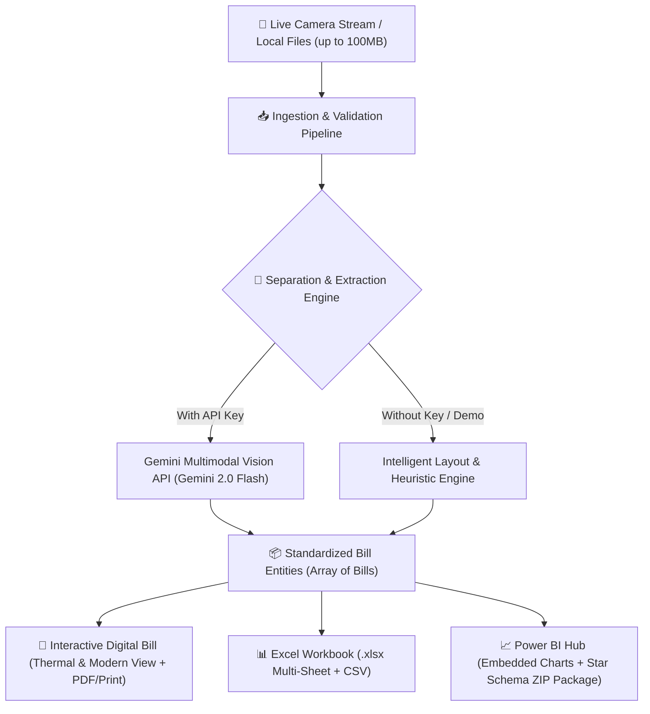

# BillSnap AI (ProApp)
### Smart Receipt OCR, Multi-Bill Separation, Digital Invoicing, Excel & Power BI Analytics

An end-to-end intelligent financial document processing platform. BillSnap AI empowers users to capture receipts live with camera or pick documents from local storage / Google Drive (up to 100MB), utilizes AI vision and layout logic to separate multiple receipts, and instantly generates interactive **Digital Bills**, **Multi-Sheet Excel Workbooks**, and a **Power BI Star-Schema Analytics Model**.

---

## 🌟 Key Features

### 1. 📷 Camera & High-Capacity File Ingestion (Up to 100MB)
- **Live Camera Scanner**: High-resolution video stream with camera flipping (front/rear environment cameras), shutter guides, snap flash, and instant preview.
- **Local File & Cloud Picker**: Drag-and-drop or select images (`JPG`, `PNG`, `WEBP`, `HEIC`) and `PDF` invoices.
- **100MB Limit**: Full client & server-side size validation with real-time processing progress indicators.
- **One-Click Test Scenarios**: Built-in test samples for grocery receipts, restaurant bills, electronics invoices, and multi-receipt photos.

### 2. 🧠 AI Vision & Multi-Bill Separation Engine
- **Multi-Bill Separation**: Detects multiple receipts captured in a single frame or multi-page invoice batch and separates them into discrete digital bills.
- **Google Gemini Multimodal Vision API**: Connect your Gemini 2.0 / 1.5 Flash API key for instant multimodal extraction of:
  - Merchant details (name, address, tax/GST ID, phone)
  - Invoice metadata (invoice/receipt number, ISO date, time, currency)
  - Itemized table (description, quantity, unit price, total, category)
  - Financials (subtotal, taxes, discounts, tips, grand total, payment method)
- **Intelligent Fallback Engine**: Works 100% offline or without an API key using layout heuristics so you can test and demonstrate the pipeline immediately.

### 3. 🧾 Interactive Digital Bill Studio
- **Dual Visual Modes**:
  - **POS Thermal Receipt View**: Monospace font, zigzag borders, barcodes, and print-cut styling.
  - **Modern Corporate Invoice View**: Formal corporate layout with category and payment channel badges.
- **Inline Editing**: Live edit any extracted merchant name, invoice numbers, prices, or line items with auto-recalculated taxes and totals.
- **Export Options**: One-click **Print Receipt** (print-styled stylesheet) and **Download PDF**.

### 4. 📊 Automated Excel Generator (.xlsx & .csv)
- **Multi-Sheet Workbook**:
  - `Sheet 1: Bills Summary`: High-level invoice register with formula sums.
  - `Sheet 2: Itemized Breakdown`: Granular item-level line entries.
- **Live Browser Spreadsheet**: Interactive table with instant search, category filtering, and TSV copy-to-clipboard for pasting straight into desktop Microsoft Excel or Google Sheets.

### 5. 📈 Power BI Integration & Star Schema Architecture
- **In-App Power BI Dashboard**:
  - KPI Executive Cards: Total Spend, Total Receipts, Average Ticket Size, Tax Paid.
  - Spending by Category (visual proportional distribution).
  - Monthly Expenditure Timeline.
  - Top Vendors Leaderboard.
- **Power BI Star Schema ZIP Package**:
  - One-click export bundling:
    - `Fact_Bills.csv` (Central fact table)
    - `Fact_BillItems.csv` (Item-level fact table)
    - `Dim_Vendors.csv` (Merchant dimension)
    - `Dim_Categories.csv` (Category dimension)
    - `PowerBI_Template_and_Measures.txt` (Ready-to-paste Power Query M-code & DAX measures)

---

## 🏗️ System Architecture



---

## 🚀 Quick Start Guide

### Prerequisites
- [Node.js](https://nodejs.org/) (v18 or higher)
- npm or yarn

### Installation

1. **Clone the repository:**
   ```bash
   git clone https://github.com/Lakshya00001/proapp.git
   cd proapp
   ```

2. **Install dependencies:**
   ```bash
   npm install
   ```

3. **Configure Environment (Optional):**
   Copy `.env.example` to `.env` and insert your Gemini API Key if you want live Google Vision extraction:
   ```bash
   cp .env.example .env
   ```
   *(Note: You can also enter or change your API key directly inside the app UI via the "AI Settings" button at any time)*.

4. **Start the local development server:**
   ```bash
   npm run dev
   ```
   Open [http://localhost:3000](http://localhost:3000) in your browser.

5. **Build for production:**
   ```bash
   npm run build
   ```

---

## 📁 Repository Structure

```
proapp/
├── public/                 # Static assets
├── src/
│   ├── components/
│   │   ├── CameraCapture.tsx     # Live WebRTC camera stream & snap modal
│   │   ├── DigitalBillView.tsx   # Thermal POS receipt & corporate invoice view
│   │   ├── ExcelExportView.tsx   # Live Excel table preview & .xlsx/.csv export
│   │   ├── FileUploader.tsx      # Drag-and-drop 100MB uploader & sample selector
│   │   ├── Header.tsx            # Navigation, tab switching, and quick actions
│   │   ├── PowerBiHub.tsx        # Power BI charts & Star Schema package exporter
│   │   └── SettingsModal.tsx     # Gemini API key and database management
│   ├── services/
│   │   ├── aiService.ts          # Gemini multimodal OCR & multi-bill split engine
│   │   ├── excelService.ts       # SheetJS multi-sheet Excel generator
│   │   └── powerBiService.ts     # Analytics calculation & Star Schema ZIP builder
│   ├── types/
│   │   └── bill.ts               # Complete TypeScript data schemas
│   ├── App.tsx                   # Main application orchestrator
│   ├── index.css                 # Tailwind directives & receipt print styling
│   ├── main.tsx                  # React entry point
│   └── vite-env.d.ts             # Vite environment typings
├── index.html                    # HTML shell
├── package.json                  # Dependencies & scripts
├── tailwind.config.js            # Tailwind CSS configuration
├── tsconfig.json                 # TypeScript compiler options
└── vite.config.ts                # Vite bundler configuration
```

---

## 📊 Power BI Desktop Setup

To import your data into Power BI Desktop:
1. In the app, switch to the **Power BI Hub** tab.
2. Click **Export Power BI ZIP (.zip)** to download the Star Schema dataset.
3. Extract the ZIP to get `Fact_Bills.csv`, `Fact_BillItems.csv`, `Dim_Vendors.csv`, and `Dim_Categories.csv`.
4. Open **Power BI Desktop** -> **Get Data** -> **Text/CSV**.
5. In Model View, relate `Fact_Bills[BillKey]` to `Fact_BillItems[BillKey]`.
6. Add the included DAX measures from `PowerBI_Template_and_Measures.txt`:
   - `Total Spend = SUM(Fact_Bills[TotalAmount])`
   - `Total Tax = SUM(Fact_Bills[TaxAmount])`
   - `Average Bill Value = AVERAGE(Fact_Bills[TotalAmount])`

---

## 🛡️ Privacy & Security
- **Camera Access**: Video streams run locally inside your browser via standard HTML5 `MediaDevices.getUserMedia` and are never stored or transmitted without user confirmation.
- **Client-Side Storage**: Bills and API keys are stored in your browser's `localStorage`.
- **API Keys**: When a Gemini key is configured, requests are made directly from your browser to Google's official Gemini API endpoints.

---

## 📜 License
MIT License. Built for modern financial workflows.
